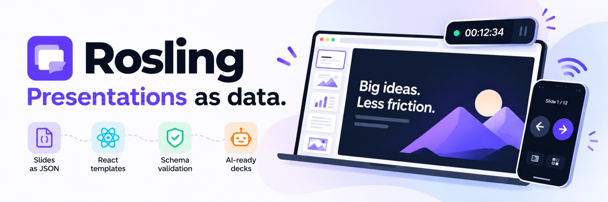

# Rosling



Make presentations by writing small JSON files, or by asking an AI agent to write them for you.
Present from the browser and use your phone as the remote.

Each slide picks a **template** (a layout) and fills in its text:

```json
{
  "template": "core/title-text",
  "values": {
    "title": "What we built",
    "bullets": ["The problem", "Our idea", "What's next"]
  }
}
```

## Quick start

You need [Node.js](https://nodejs.org) 20.19 or newer.

```sh
npm install -g rosling     # install the rosling command (once)
rosling init my-talk       # make a new deck
cd my-talk
rosling dev                # open the live preview
```

Open the address it prints (usually http://localhost:3030). You'll see three starter slides.

## Make slides with AI (recommended)

Every deck comes with an `AGENTS.md` file that teaches AI coding agents (Claude Code, Codex, Cursor,
Gemini, Copilot...) how Rosling works. So you can just ask.

1. Keep `rosling dev` running in one terminal.
2. Open your AI agent in the `my-talk` folder, in a second terminal or your editor.
3. Ask for what you want:

   > Make me a 10-minute talk about how our app saves people time. About 8 slides.

   > Add a slide after the agenda comparing the old way and the new way.

The preview updates as the agent saves files.

**Give feedback right on the slides.** Connect your agent once:

```sh
rosling connect claude     # or: codex, gemini, cursor
```

Restart the agent and ask it to *listen for my slide comments* (in Claude Code: `/rosling-review`).
In the preview, click **Comment**, click a spot on a slide, and write what should change. Press
**Send all**. The agent makes the changes and replies on the slide.

**Using Claude Desktop instead?** Run `rosling connect claude-desktop --deck ~/talks`, restart
Claude Desktop, and ask it to make a talk. Then open it with `rosling dev --deck ~/talks/<deck>`.

## Make slides by hand

Each slide is a file in `slides/`. The order of the talk is the `slides` list in `deck.json`.

```sh
rosling template list --props                        # see the layouts and what they need
rosling new the-problem --template core/title-text   # add a slide
```

Open `slides/the-problem.json`, change the text, save. The preview updates. Run `rosling check` to
find anything that doesn't fit (text too long, a missing title...).

## Make your own template

The built-in templates are a start. When you need a layout they don't have, make your own.

**With AI:** describe the layout to your agent.

> Make a new template called `timeline` that shows 3 to 6 milestones in a row, each with a date and
> a short label. Then use it for a roadmap slide.

The agent creates it in `templates/timeline/`. Click **Templates** in the preview to see it.

**By hand:**

```sh
rosling template new timeline
```

This makes `templates/timeline/` with four files, copied from a simple working template:

| File | What you change |
|---|---|
| `template.json` | The boxes the slide fills in (title, items, image...) and their limits |
| `sample.json` | Example values, shown in the gallery |
| `Template.tsx` | The React component that draws the slide |
| `style.module.css` | Its styles |

Use it in a slide as `"template": "local/timeline"`. The step-by-step guide is in
[docs/TEMPLATES.md](docs/TEMPLATES.md).

## Present

```sh
rosling present
```

Open the address, click **Phone remote** and scan the QR code with your phone (same Wi-Fi).
Press **Present** (or `P`). Your phone shows next/previous buttons, your notes, and the timers.

## Learn more

- [docs/GETTING-STARTED.md](docs/GETTING-STARTED.md): a slower walkthrough, for your first deck
- [docs/TEMPLATES.md](docs/TEMPLATES.md): making templates, step by step
- [docs/REFERENCE.md](docs/REFERENCE.md): all commands, packs, the phone remote, AI tools (MCP), and working on Rosling itself
